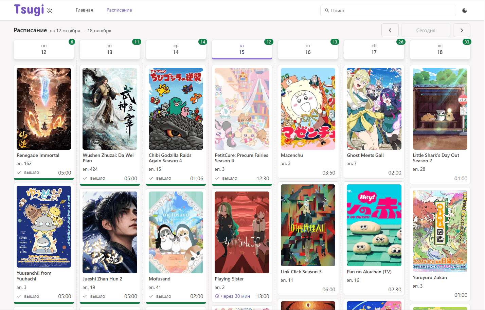
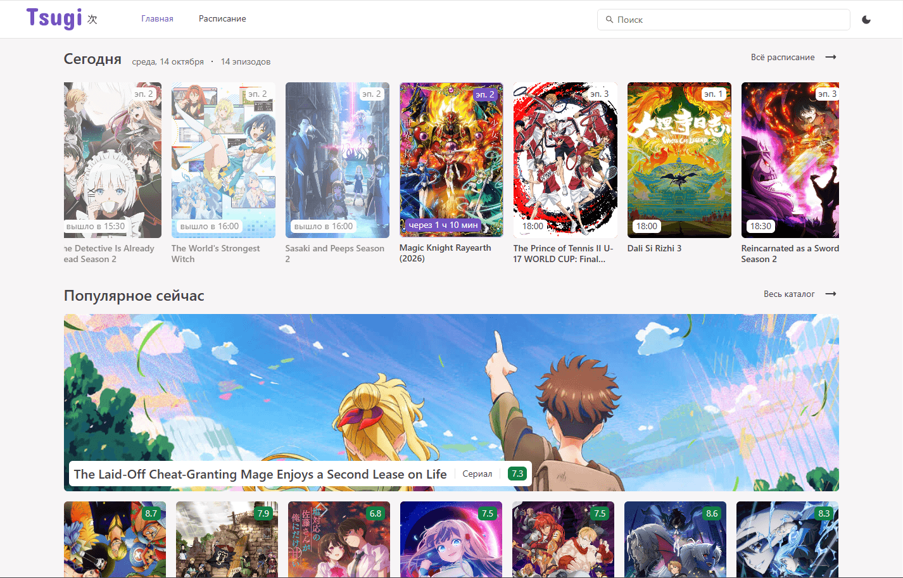
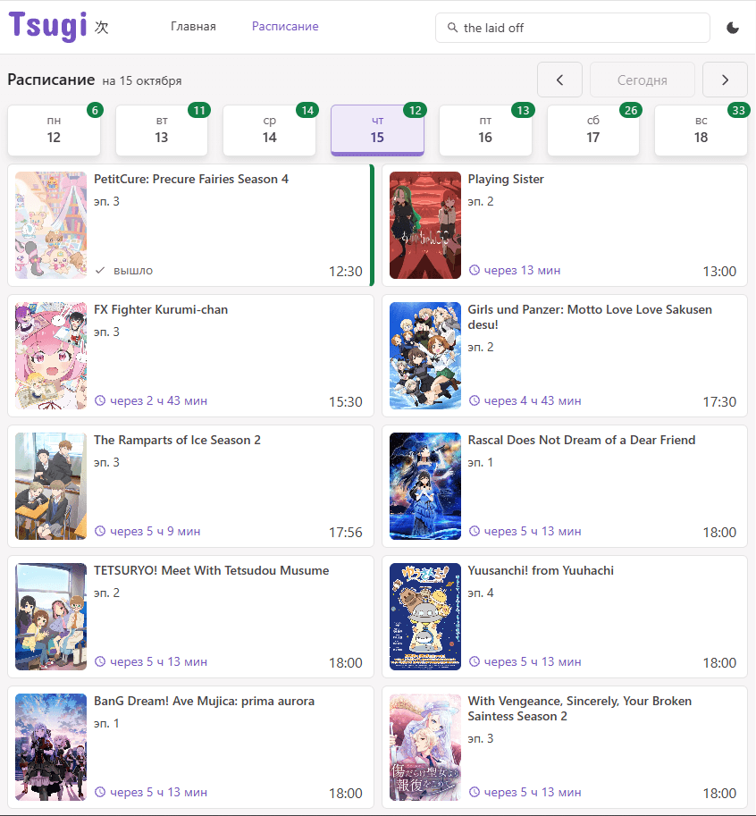
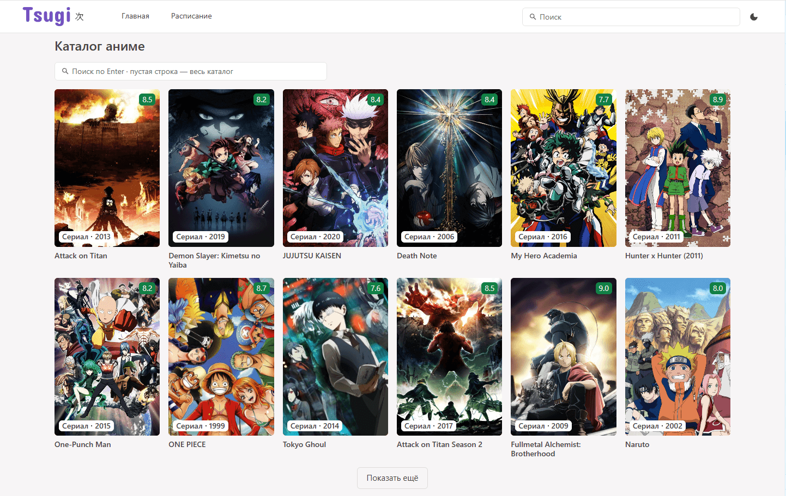
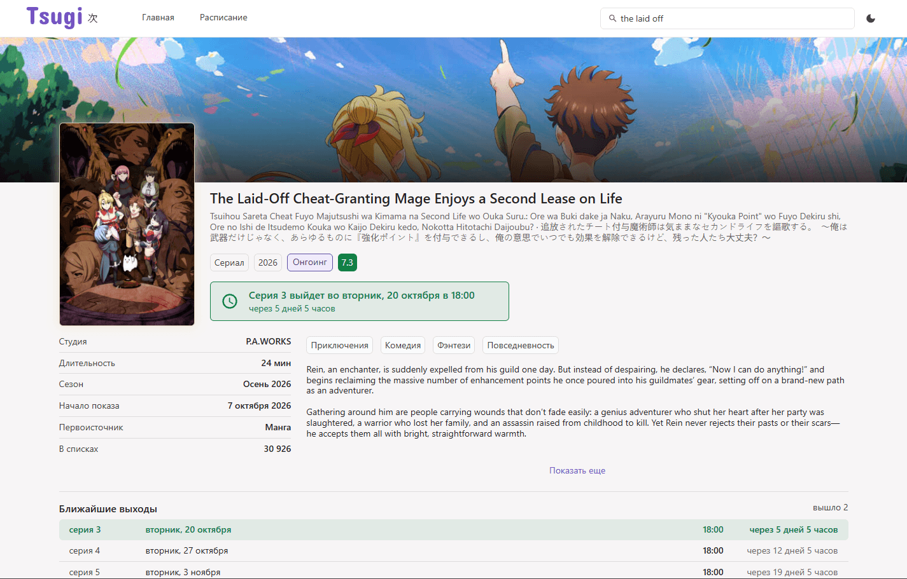

# Tsugi <!-- omit from toc -->

**Tsugi** — это веб-приложение для отслеживания выхода новых эпизодов аниме. Название проекта происходит от японского 次 («следующий»). Основа проекта — календарь выхода серий: у серий, которые выходят сегодня, показан отсчёт до выхода, и он обновляется сам, без перезагрузки страницы. Данные — из API AniList.

**[Открыть Tsugi](https://tsugi-three.vercel.app/#/schedule)** (из России сайт открывается нестабильно, используйте VPN)

<picture>
  <source media="(prefers-color-scheme: dark)" srcset="docs/screenshots/schedule_dark.png">
  
</picture>

## Цель проекта

Пет-проект для портфолио. Приоритет — качество исполнения, а не количество фич: законченность, читаемый код, типобезопасность, обработка краевых случаев и внятная документация.

## Содержание <!-- omit from toc -->

- [Цель проекта](#цель-проекта)
- [Что умеет](#что-умеет)
  - [Главная](#главная)
    - [Блок «Сегодня»](#блок-сегодня)
    - [Блок «Популярное сейчас»](#блок-популярное-сейчас)
  - [Расписание](#расписание)
  - [Быстрый поиск](#быстрый-поиск)
  - [Каталог аниме (Поиск)](#каталог-аниме-поиск)
  - [Страница тайтла](#страница-тайтла)
  - [Прочее](#прочее)
- [Почему так](#почему-так)
- [Технологии](#технологии)
- [Структура проекта](#структура-проекта)
- [Документация и что дальше](#документация-и-что-дальше)
- [Разработка](#разработка)
  - [Требования](#требования)
  - [Установка зависимостей](#установка-зависимостей)
  - [Запуск dev-сервера](#запуск-dev-сервера)
  - [Генерация типов для GraphQL](#генерация-типов-для-graphql)
  - [Создание билда](#создание-билда)
- [Как делался проект](#как-делался-проект)
- [Источники](#источники)
- [Контакты](#контакты)

## Что умеет

### Главная

<details>
<summary>Скриншот</summary>

<picture>
  <source media="(prefers-color-scheme: dark)" srcset="docs/screenshots/home_dark.png">
  
</picture>

</details>

#### Блок «Сегодня»

Отображает, какие серии выходят сегодня и какая серия выйдет в ближайшее время. При загрузке страницы прокрутка идёт к ближайшей выходящей серии, а если все уже вышли — к последней. Время выхода показано в вашем часовом поясе.

#### Блок «Популярное сейчас»

Содержит баннер и сетку трендовых тайтлов, а также ссылку на каталог.

### Расписание

<details>
<summary>Скриншоты</summary>

<picture>
  <source media="(prefers-color-scheme: dark)" srcset="docs/screenshots/schedule_dark.png">
  
</picture>

<picture>
  <source media="(prefers-color-scheme: dark)" srcset="docs/screenshots/schedule_narrow_dark.png">
  
</picture>

</details>

Расписание содержит календарь выхода серий. На широких экранах неделя разложена вертикальными колонками по дням, на узких показывается один выбранный день.

При первом открытии календаря отображается текущая неделя, которую можно менять стрелками. Кнопка «Сегодня» возвращает к текущей дате. На узких экранах день выбирается кнопками дней над списком.

На карточках эпизодов отображаются обложка, название тайтла, номер эпизода, а также время выхода, отсчет до выхода для всех сегодняшних невышедших серий и метка «вышло» для вышедших серий. Также вышедшие серии помечаются зеленой полосой.

### Быстрый поиск

Быстрый поиск тайтлов расположен в шапке. Поиск происходит автоматически при наборе текста от трех символов, а по нажатию `Enter` вы попадёте на страницу поиска аниме с сохранением введенного текста.

### Каталог аниме (Поиск)

<details>
<summary>Скриншот</summary>

<picture>
  <source media="(prefers-color-scheme: dark)" srcset="docs/screenshots/search_dark.png">
  
</picture>

</details>

На страницу поиска пользователь может попасть из блока «Популярное сейчас» по ссылке «Весь каталог» на главной или по нажатию `Enter` в быстром поиске в шапке. Поиск выполняется сразу при заходе на страницу: текст запроса считается пустой строкой (или берется из быстрого поиска). При пустом запросе отображается весь каталог с сортировкой по популярности. Запуск нового поиска осуществляется по `Enter`. Одна страница выдачи — это 12 тайтлов (2 ряда на широком экране), следующие страницы загружаются кликом по «Показать ещё».

### Страница тайтла

<details>
<summary>Скриншот</summary>

<picture>
  <source media="(prefers-color-scheme: dark)" srcset="docs/screenshots/card_dark.png">
  
</picture>

</details>

Страница содержит баннер, обложку, тип тайтла, год выхода, статус выхода, рейтинг и таблицу с основными фактами о тайтле.
Если тайтл является онгоингом, то вы увидите плашку с отображением времени выхода ближайшей серии, а также блок будущих серий: в нём отображаются ближайшие четыре эпизода, а весь список можно развернуть кнопкой «Показать все». Страница также содержит описание и теги жанров.

### Прочее

У экранов есть отдельные состояния загрузки, ошибки и пустого результата. При загрузке страниц отображаются скелетоны.

На странице поиска, если выдача оказалась пустой, будет отображена плашка «Ничего не нашлось». Если запрос поиска завершится ошибкой, вы увидите плашку «Не удалось загрузить» с кнопкой повтора. Если же не выполнится дозагрузка по кнопке «Показать ещё», появится всплывающее сообщение «Не удалось загрузить. Попробуйте ещё раз», а кнопку можно нажать повторно.

На странице тайтла различаются две ошибки: если такого тайтла нет в AniList, отображается «Такого тайтла нет» со ссылками на расписание и поиск, а если данные не пришли из-за связи — «Не удалось загрузить» с кнопкой повтора.

В расписании при ошибке загрузки недели отображается сообщение «Данные где-то потерялись» с кнопкой «Повторить загрузку».

Для некорректных адресов отображается страница 404.

Приложение поддерживает два языка: английский и русский. Переключение языков в приложении в планах.
Есть светлая и темная темы. Тема переключается вручную кнопкой в шапке, а при первом заходе берётся из настроек системы.

## Почему так

1. Выбор открытого API

   Выбор стоял между **AniList** и **Jikan**. Итоговым выбором стал **AniList** по нескольким причинам:
   - возможность запроса конкретных полей без оверфетча;
   - есть `bannerImage` и `coverImage.color` для эстетики отображения;
   - есть `airingSchedule` — без него ключевая фича была бы невозможна;
   - мягче лимиты (у Jikan 3 req/sec, 60/min — поиск с дебаунсом упирается);
   - есть OAuth и мутации — задел на синхронизацию личного списка.

2. Типизация

   Типы **AniList** генерируются через `@graphql-codegen`, т. к. рукописные типы неизбежно бы расходились с запросами, о которых не узнал бы компилятор. Для типизации отдельных блоков используется `fragment`.

   Компоненты принимают не конкретный сгенерированный тип, а минимальный — только поля, которые читают. Например, карточке `CoverCard` нужны лишь `id`, название и обложка, поэтому одна и та же карточка работает с данными расписания, популярного и поиска, хотя запросы и фрагменты у них разные.

   Типы генерируются только с `typescript-operations`, т. к. с плагином `typescript` генерировались `type` и `enum` с одинаковыми названиями, что приводило к ошибке компилятора.

3. Кеширование расписания

   Загруженные недели для календаря кешируются. Если запрошенная неделя была в прошлом, ее контент не будет перезапрашиваться, а если текущая или будущая, то она перезапросится, если ее данные старше 15 минут.

   Если сначала открыть главную, текущая неделя уже загружена для блока «Сегодня», и расписание открывается без нового запроса — у них общий кеш.

4. Гонки запросов

   Для быстрого поиска добавлены дебаунс и отмена запросов. Дебаунс уменьшает число запросов, но не порядок ответов: дописал букву — и ответ на прежнюю строку может прийти позже и перетереть свежий, поэтому добавлена отмена предыдущего запроса.

   Переход по `Enter` из быстрого поиска гасит и отложенный вызов дебаунса, и запрос в пути. Иначе ответ приходил после перехода и заново открывал выпадашку уже на новой странице.

5. Поиск: «Показать ещё»

   Стор держит одну, последнюю выдачу, поэтому при клике на тайтл и возврате с него запроса нет, и позицию возвращает роутер через `scrollBehavior`. Можно открывать тайтлы один за другим и возвращаться в выдачу на то же место. `scrollBehavior` понадобился и по второй причине: без него новая страница наследовала прокрутку предыдущей, и тайтл, открытый из низа каталога, открывался в самом низу. Правило роутера: при «назад» и «вперёд» — сохранённая позиция, при обычном переходе — наверх.

   От пагинации отказались ради удобства «Показать ещё»: оно дает одну непрерывную ленту без кликов по номерам страниц, и на телефоне листать проще. Пагинация, наоборот, выигрывает тем, что номер страницы попадает в адрес, и ссылка ведёт ровно на ту страницу. Этим пожертвовали ради ленты.

6. Сознательно не сделано

   В MVP не вошли — сроки были ограничены, а законченные экраны лучше недоделанных:
   - Личный список
   - Фильтры в поиске

## Технологии

- [Vue 3](https://vuejs.org/)
- [TypeScript](https://www.typescriptlang.org/)
- [Pinia](https://pinia.vuejs.org/)
- [Vue Router](https://router.vuejs.org/)
- [Naive UI](https://naiveui.com/en-US/os-theme)
- [AniList GraphQL](https://docs.anilist.co/)
- [codegen](https://the-guild.dev/graphql/codegen)
- [Axios](https://axios-http.com/)
- [Vite](https://vite.dev/)
- [Vercel](https://vercel.com/)
- [vue-i18n](https://vue-i18n.intlify.dev/)
- [dayjs](https://day.js.org/)
- [Sass (SCSS)](https://sass-lang.com/)

## Структура проекта

```
src/
  api/            запросы к AniList: клиент, функция запроса
    gql/          тексты запросов и фрагментов GraphQL
    generated/    типы, сгенерированные codegen, руками не правятся
  stores/         Pinia: данные, загрузка, ошибки и кеш — по стору на предметную область
  views/          страницы, по одной на маршрут
  components/     общие компоненты (карточки, картинка обложки, пустые состояния)
    Carousel/     компоненты конкретных экранов
    Home/
    Schedule/
    Search/
  composables/    переиспользуемая логика: общий таймер, отмена запросов, медиазапросы
  utils/          чистые функции для дат, времени и названий
  locales/        переводы ru и en
  styles/         сброс стилей, цветовая тема, SCSS-переменные и миксины
  router/         маршруты и поведение прокрутки
```

Данные идут в одну сторону: `api` → `stores` → `views` и `components`. Компоненты не обращаются к API сами — загрузка, ошибка и кеш живут в сторе, и два компонента не запросят одно и то же дважды. Исключение — подсказки быстрого поиска в шапке: их состояние живёт секунды и никому больше не нужно.

Запросы лежат только в `api/gql`: на эту папку смотрит codegen, и по ней генерируются типы.

## Документация и что дальше

Проект ведётся по ТЗ — [docs/spec.md](docs/spec.md). Там по каждому экрану записаны принятые решения с датами, отвергнутые варианты и замеры, на которых решения основаны, а также технический долг.

Что дальше:

- тесты на Vitest, линтер и форматтер;
- мобильная версия: страница тайтла и шапка с поиском на узких экранах;
- фильтры в каталоге;
- личный список и переключатель языка;
- возрастной барьер на странице тайтла: размытие обложки и баннера с подтверждением для тайтлов 18+;
- сохранение кеша расписания между заходами (`localStorage` или IndexedDB): сейчас загруженные недели живут только до перезагрузки страницы.

## Разработка

### Требования

Для установки и запуска проекта необходим [NodeJS](https://nodejs.org/) v22.12+.

### Установка зависимостей

Для установки зависимостей выполните команду:

```sh
npm i
```

### Запуск dev-сервера

Чтобы запустить сервер для разработки, выполните команду:

```sh
npm run dev
```

Локально запросы идут напрямую к AniList, а он и его картинки из России недоступны, поэтому используйте VPN.

### Генерация типов для GraphQL

При добавлении новых запросов используйте генерацию типов `@graphql-codegen`:

```sh
npm run codegen
```

### Создание билда

Чтобы выполнить production-сборку, выполните команду:

```sh
npm run build
```

## Как делался проект

Код написан мной. В работе я использовала Claude (Anthropic) как ревьюера и собеседника: код-ревью, разбор вариантов решений и багов, сверка ТЗ с кодом, вычитка README. Решения в проекте и их обоснования — мои; ход рассуждений по ним записан в [ТЗ](docs/spec.md).

## Источники

Вдохновение для UI и фич:

- [Yummy Anime](https://ru.yummyani.me/)
- [Anime Go](https://animego.me/)
- [AniList](https://anilist.co/)
- [Crunchyroll](https://www.crunchyroll.com/)
- [Shikimori](https://shikimori.io)

## Контакты

- Автор: Холина Дарья Андреевна
- Резюме: [на hh.ru](https://spb.hh.ru/resume/cef0c9a4ff09b2f5340039ed1f6f4649376152)
- Почта: holina-dasha@mail.ru
