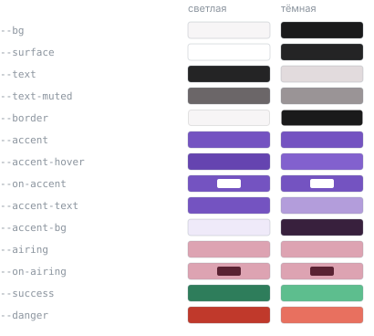

# Tsugi — техническое задание

> Версия 3. Заменяет черновик `ТЗ OtakuList.docx` (оставлен как есть, для истории).
> Дата: 04.08.2026

---

## 1. О проекте

**Tsugi** (次 — «следующий», «дальше») — веб-приложение для отслеживания аниме: каталог, поиск с фильтрами, личный список и **календарь выхода серий**.

Название отвечает на главный вопрос продукта — что следующее и когда. Прежнее рабочее название — OtakuList.

**Цель проекта:** пет-проект для портфолио. Отсюда следует, что приоритет — не количество фич, а качество исполнения: законченность, читаемый код, типобезопасность, обработка краевых случаев и внятная документация. Лучше пять доведённых до конца экранов, чем пятнадцать наполовину.

**Ключевая фича, отличающая проект от типового каталога:** календарь выхода серий с привязкой к личному списку. Каталог открывают один раз, расписание — каждую неделю.

---

## 2. Стек

| Категория    | Технология           | Зачем                                                       |
| ------------ | -------------------- | ----------------------------------------------------------- |
| Фреймворк    | Vue 3                | Composition API, `<script setup>`                           |
| Язык         | TypeScript           | `strict: true`                                              |
| Сборка       | Vite                 | Быстрый dev, HMR                                            |
| Стейт        | Pinia                | Сторы, кеш                                                  |
| Роутер       | Vue Router           | Навигация, query-параметры как источник истины для фильтров |
| UI           | Naive UI             | Готовые компоненты, тёмная тема                             |
| HTTP         | Axios                | Запросы, интерсепторы                                       |
| Препроцессор | SCSS                 | Переменные, миксины                                         |
| Локализация  | vue-i18n             | ru / en                                                     |
| Даты         | dayjs                | Плагины: `isoWeek`, `duration`, `localizedFormat`           |
| **API**      | **AniList GraphQL**  | `https://graphql.anilist.co`                                |
| **Типы API** | **@graphql-codegen** | Генерация типов из схемы, без ручного дублирования          |
| Деплой       | Vercel / Netlify     | Бесплатный хостинг                                          |

### Решение по API

**Jikan отменён, выбран AniList GraphQL.** Обоснование (в README вынести отдельным разделом):

- запрос ровно нужных полей, без оверфетча;
- есть `bannerImage` и `coverImage.color` — на них построена главная;
- есть `airingSchedule` — без него ключевая фича невозможна;
- мягче лимиты (у Jikan 3 req/sec, 60/min — поиск с дебаунсом упирается);
- есть OAuth и мутации — задел на синхронизацию личного списка.

Минус: нет русских названий (у Jikan тоже нет). Принимаем.

**Приложение обращается к двум внешним адресам** (замерено 16.08.2026 на экране расписания):

| Хост                 | Что               | Запросов на экран |
| -------------------- | ----------------- | ----------------- |
| `graphql.anilist.co` | API               | 3                 |
| `s4.anilist.co`      | обложки и баннеры | 122               |

Больше внешних обращений нет — `@vicons` и шрифты бандлятся в сборку.

Обрати внимание на пропорцию: почти весь сетевой трафик экрана — это изображения, а не данные. Это главный рычаг, если понадобится ускорить загрузку.

### Решение по типам

Типы GraphQL-ответов **не пишутся руками**. Подключается `@graphql-codegen` со схемой AniList; типы генерируются в `src/api/generated/`. Причина: рукописные типы неизбежно расходятся с запросами, и компилятор об этом не узнает.

---

## 3. Палитра и айдентика



### Токены

| Токен            | Светлая              | Тёмная                  | Назначение                          |
| ---------------- | -------------------- | ----------------------- | ----------------------------------- |
| `--bg`           | `#F7F5F6`            | `#1A1A1B`               | фон страницы                        |
| `--surface`      | `#FFFFFF`            | `#242425`               | карточки, хедер                     |
| `--text`         | `#242425`            | `#E2DBDD`               | основной текст                      |
| `--text-muted`   | `#6B6668`            | `#9A9496`               | подписи, метаданные, время эфира    |
| `--border`       | `rgba(36,36,37,.12)` | `rgba(226,219,221,.14)` | рамки, разделители                  |
| `--accent`       | `#7453C1`            | `#7453C1`               | заливка кнопок, активные состояния  |
| `--accent-hover` | `#6544B0`            | `#8261CE`               | наведение                           |
| `--on-accent`    | `#FFFFFF`            | `#FFFFFF`               | текст на акцентной заливке          |
| `--accent-text`  | `#7453C1`            | `#B39DDB`               | акцентный текст, ссылки             |
| `--accent-bg`    | `#EFEAF9`            | `#38203D`               | подложка акцентных плашек           |
| `--airing`       | `#DDA3B2`            | `#DDA3B2`               | «выходит сегодня», «в эфире»        |
| `--on-airing`    | `#5A2233`            | `#5A2233`               | текст на розовой плашке             |
| `--success`      | `#2E7D5B`            | `#5DBE8E`               | подтверждения, статус «просмотрено» |
| `--danger`       | `#C0392B`            | `#E8705F`               | ошибки                              |

Нейтральные слегка тёплые: `#F7F5F6` и `#E2DBDD` содержат розовую подмешку, поэтому воспринимаются как молочно-серые, а не стальные.

`--warning` намеренно не заводим: в этом приложении ему нечего обозначать, а цвет без назначения начинают применять наугад. Появится смысл — появится токен.

Все значения проверены на контраст к своему фону: цветной текст даёт не меньше 4.5, заливки с белым текстом — не меньше 4.5. Исключение — `--accent` как крупный текст на тёмном (2.8), поэтому для текста и ссылок существует отдельный `--accent-text`.

### Правило двух акцентов

- **Фиолетовый — «можно нажать» и «моё»:** кнопки, ссылки, активный пункт меню, пометка «в моём списке».
- **Розовый — состояние во времени:** выходит сегодня, в эфире.

Одно про действие, другое про факт — так они не конкурируют за внимание и не путают пользователя.

Имя `--airing` намеренно узкое, по смыслу. Если у розового появится вторая работа — переименовать.

### Почему токены, а не переменные SCSS

**Переменные Sass не умеют темы.** `$main-color` подставляется при сборке, и в готовом CSS никакой переменной нет — только конкретный цвет. Поменять его в рантайме невозможно, значит переключить тему на переменных Sass нельзя в принципе.

Отсюда три слоя:

1. **Палитра** — переменные Sass (`$violet-500`, `$violet-300`). Сырые цвета, compile-time, о темах не знают.
2. **Токены** — два блока CSS-переменных: `:root` и `:root[data-theme='dark']`. Здесь роли получают значения из палитры.
3. **Компоненты** — только `var(--surface)`, `var(--text)`. Про палитру не знают и знать не должны.

Компонент говорит «залей меня акцентом», а какой это цвет в текущей теме — решает тема. Без этого разделения темизация превращается в набор точечных переопределений «а в тёмной теме здесь другой цвет».

### Стыковка с Naive UI

Своих цветов недостаточно: у Naive UI собственная тема, и по умолчанию её `primaryColor` зелёный (`#18a058`). Без переопределения половина интерфейса останется зелёной — как сейчас активный пункт меню.

`n-config-provider` в `App.vue` уже есть, не хватает пропа `theme-overrides`:

```ts
import { darkTheme, lightTheme, type GlobalThemeOverrides } from "naive-ui";

const darkOverrides: GlobalThemeOverrides = {
  common: {
    primaryColor: "#7453C1",
    primaryColorHover: "#8261CE",
    primaryColorPressed: "#6544B0",
    primaryColorSuppl: "#7453C1",

    bodyColor: "#1A1A1B",
    cardColor: "#242425",
    textColorBase: "#E2DBDD",
    textColor3: "#9A9496",
    borderColor: "rgba(226,219,221,.14)",
    successColor: "#5DBE8E",
    errorColor: "#E8705F",
    borderRadius: "8px",
  },
};
```

Три грабли:

- **`primaryColorSuppl` обязателен.** Naive использует его для плотных заливок — залитые кнопки, активный переключатель, ползунок. Задашь только `primaryColor` — часть компонентов останется зелёной.
- **Приглушённый текст — не `textColorBase`.** У Naive нумерованные уровни `textColor1…3`, метаданные берут из третьего.
- **Покомпонентные правки** кладутся в ключи с именами компонентов рядом с `common`: `Button`, `Menu`, `Card`. Сначала настраивается `common`, компоненты наследуют.

### Айдентика

Логотип — три варианта: `logo-black`, `logo-light-theme`, `logo-dark-theme`.

**TODO после переименования в Tsugi:**

- Перерисовать все три `.svg` — текст в них переведён в кривые, слово «OtakuList» зашито в контуры пути.
- Заменить `favicon.svg` (сейчас стандартный от Vite).

---

## 4. Архитектура

### Роуты

| Роут              | Экран                  | В MVP |
| ----------------- | ---------------------- | ----- |
| `/`               | Главная                | да    |
| `/schedule`       | Календарь выхода серий | да    |
| `/search`         | Поиск с фильтрами      | да    |
| `/anime/:id`      | Детали тайтла          | да    |
| `/my-list`        | Мой список             | да    |
| `/:pathMatch(.*)` | 404                    | да    |

`RouterEnum` привести в соответствие с реальными роутами: `Community`, `Events`, `Movies`, `Series` объявлены, но не существуют — убрать до момента реализации.

История роутера: перейти на `createWebHistory` (сейчас `createWebHashHistory`). URL без `#` читаются лучше, а SPA-rewrite на Vercel настраивается одним файлом `vercel.json`.

### Структура файлов

```
src/
  api/                    слой доступа к данным, о UI не знает ничего
    client.ts             axios-инстанс: базовый URL, таймаут, перехват ошибок GraphQL
    request.ts            graphqlRequest — обобщённая функция запроса
    gql/                  тексты запросов и фрагментов
      requests.ts
    generated/            вывод codegen, руками не редактируется
      graphql.ts
  stores/                 Pinia: состояние, кеш, вызовы api
    animeList.ts
  views/                  компоненты-страницы, по одному на роут
  components/             переиспользуемые компоненты
  utils/                  чистые функции: ни реактивности, ни сети, ни DOM
    media.ts
  router/
  locales/                vue-i18n: ru.json, en.json, index.ts
  styles/                 reset, variables, mixins, common
  assets/                 статика, импортируемая из кода (логотипы)
  types/                  собственные типы, не связанные с API
  App.vue
  main.ts
```

### Принципы

**Поток данных в одну сторону: `api → stores → views/components`.** Компонент не обращается к `api` напрямую, только через стор. Причина практическая: загрузка, ошибка и кеш живут в одном месте. Иначе два компонента, которым нужны одни данные, запросят их дважды и каждый будет крутить свой скелетон.

**Зависимости направлены внутрь.** `api/` не знает о компонентах. `utils/` не знает ни о чём — функции там принимают минимальные структурные типы, а не сгенерированные, и поэтому не ломаются при перегенерации схемы и тестируются без окружения.

**Файл на предмет, а не свалка.** Никакого `utils/index.ts`, куда складывается всё. Имя файла отвечает на вопрос «про что», а не «какого технического рода». Когда в одном файле набирается больше пяти функций про разные вещи — делить по предметам.

**Запросы живут в `api/gql/`, не рядом с компонентами.** Кроме порядка, есть техническая причина: `documents` в `codegen.ts` указывает только на эту папку, поэтому синтаксическая ошибка в компоненте не ломает генерацию типов.

**`api/generated/` не редактируется руками** — при следующем запуске `npm run codegen` правки исчезнут. Файл при этом **коммитится**: иначе сборка на чистой машине и деплой начинают зависеть от доступности AniList. Риск расхождения закрывается проверкой в CI (11.2): перегенерировать и упасть, если результат отличается от закоммиченного. В `.gitattributes` помечен как `linguist-generated`, чтобы не засорять диффы.

**`views/` против `components/`.** В `views/` попадает только то, что подключено в роутере, один файл на роут. Остальное — в `components/`, даже если компонент используется одной страницей. Группировка по папкам внутри `components/` появится, когда их станет больше десятка, не раньше.

**Стили подключаются глобально.** `reset`, `variables` и `mixins` инжектятся в каждый SCSS-блок через `additionalData` в `vite.config.ts`. Поэтому в компонентах можно писать `$base-padding` без импорта — это не магия Vue, а настройка сборки, и о ней надо знать, чтобы не искать несуществующий импорт.

**Заранее ничего не создаём.** `composables/` для переиспользуемой реактивной логики (`useXxx`) появится, когда возникнет второй компонент с одинаковым поведением, а не в ожидании этого.

### Соглашения об именах

| Что                | Как            | Пример              |
| ------------------ | -------------- | ------------------- |
| Компоненты и вьюхи | PascalCase     | `AnimeCard.vue`     |
| Остальные файлы    | camelCase      | `animeList.ts`      |
| Сторы              | `useXxxStore`  | `useAnimeListStore` |
| GraphQL-операции   | PascalCase     | `GetTopAnime`       |
| Фрагменты          | по потребителю | `AnimeCardMedia`    |

---

## 5. Экраны

Для каждого экрана обязательны четыре состояния: **loading**, **error + повтор**, **empty**, **success**. Отсутствие empty- и error-состояний — самая частая претензия на ревью.

### 5.1 Главная `/`

**Блоки сверху вниз:**

1. **Баннер-карусель** — популярные тайтлы, `bannerImage` на всю ширину, автопрокрутка. Уже реализовано.
   - **TODO: виньетка поверх каждой картинки слайда.** Задумана как радиальный градиент от прозрачного центра к затемнённым краям (`radial-gradient(ellipse at center, transparent 50%, rgba(0,0,0,.6) 100%)`), поверх слайда, с `pointer-events: none`. Черновик был, но не заработал и остался закомментированным — код убран при чистке, требование зафиксировано здесь. Нужна, чтобы текст поверх баннера читался на любой обложке.
2. **Сегодня выходит** — горизонтальный ряд из 5–6 `EpisodeCard` + ссылка «Всё расписание →». Если сегодня релизов нет — блок показывает ближайший день с релизами и подпись «Ближайшие релизы: пятница».
3. **Популярные** — горизонтальный слайдер карточек. Уже реализовано, требует рефакторинга (см. 9).

**Состояния:** скелетоны на время загрузки каждого блока независимо; ошибка одного блока не роняет остальные.

### 5.2 Календарь `/schedule` — ключевой экран

**Десктоп (≥1024px):** сетка из 7 колонок, понедельник — воскресенье. Каждая колонка: заголовок (день недели, число), под ним карточки эпизодов, отсортированные по времени эфира.

**Мобильный (<1024px):** горизонтальная полоса дней недели как навигация (число, день, счётчик релизов), под ней — список эпизодов выбранного дня.

**Элементы:**

- **Шапка:** диапазон недели («27 июля — 2 августа»), кнопки «← неделя», «Сегодня», «неделя →».
- **Фильтр «Только мой список»** — переключатель, состояние в query-параметре. Источник списка — слияние публичного списка AniList по нику и локальных пометок (5.5). Если ни ника, ни локальных пометок нет — подсказка со ссылкой на «Мой список», а не пустая сетка.
- **Сегодняшняя колонка** визуально выделена акцентом.
- **Карточка эпизода (`EpisodeCard`)**: обложка, название, номер эпизода, время эфира в локальной зоне пользователя. Тайтлы из личного списка помечены акцентной рамкой и бейджем.
- **Обратный отсчёт** до ближайшего невышедшего эпизода: «через 2 ч 14 мин».
- **Уже вышедшие сегодня** эпизоды приглушены (opacity) и помечены «вышло».
- **День без релизов** — колонка остаётся на месте с текстом «нет релизов». Дни не выпадают из сетки.

**Навигация:** клик по карточке ведёт на `/anime/:id`.

**Состояния:** скелетон-сетка из 7 колонок; ошибка с кнопкой повтора; «на этой неделе релизов нет» (реально бывает в межсезонье).

### 5.3 Поиск `/search`

**Фильтры:** строка поиска, жанры (мультиселект), год, сезон, формат (TV / Movie / OVA / ONA / Special), статус, сортировка (популярность / рейтинг / дата выхода).

**Требование:** все фильтры отражаются в query-параметрах URL и восстанавливаются из них при загрузке страницы. Ссылку с фильтрами можно скопировать и открыть в другой вкладке — состояние совпадёт. Синхронизация двусторонняя: изменение фильтра → `router.replace` (не `push`, чтобы не засорять историю); переход «назад» → фильтры перечитываются из URL.

**Ввод в строку поиска** — дебаунс 400 мс. Отмена предыдущего запроса при новом вводе (гонки ответов недопустимы: медленный ответ на старый запрос не должен перетирать свежий).

**Выдача:** сетка карточек, бесконечная подгрузка или пагинация — на выбор, но одно из двух.

**Состояния:** loading (скелетоны), «ничего не найдено» с подсказкой сбросить фильтры, ошибка.

### 5.4 Детали `/anime/:id`

Баннер, обложка, названия (romaji / english / native), описание, оценка, жанры, студия, статус, количество эпизодов, даты выхода, трейлер (у AniList поле `trailer` есть).

Связанные тайтлы и рекомендации — не в MVP, вынесено в roadmap (11.6).

**Блок расписания:** если тайтл ещё выходит — «Эпизод 7 выйдет 30 июля в 18:30, через 2 дня».

**Кнопка «В мой список»** с выбором статуса (значения — см. 5.5).

### 5.5 Мой список `/my-list`

#### Что даёт AniList

У AniList есть две независимые сущности, и путать их нельзя:

| Сущность       | Что это                                      | Мутация              | Чтение                                        |
| -------------- | -------------------------------------------- | -------------------- | --------------------------------------------- |
| **MediaList**  | Полноценный список: статус, прогресс, оценка | `SaveMediaListEntry` | `MediaListCollection(userName:, type: ANIME)` |
| **Favourites** | Отдельное «избранное», просто набор отметок  | `ToggleFavourite`    | `User.favourites`                             |

Нам нужен **MediaList** — он несёт статус и прогресс, а не только факт отметки.

**Запись требует авторизации.** Чтение публичного списка по нику — не требует (на этом строится сравнение списков, 11.4).

#### Два источника списка в MVP

Авторизации в MVP нет (решение зафиксировано, OAuth — 11.3). Вместо неё список собирается из двух слоёв:

**Слой 1 — публичный список AniList по нику, только чтение.** Пользователь указывает свой ник; приложение читает его открытый список. Авторизация не нужна — публичные списки доступны всем.

**Слой 2 — локальные пометки в `localStorage`.** То, что человек отметил в самом приложении. В аккаунт AniList не уезжает.

**Слияние:** оба слоя приводятся к одной форме — объект по `mediaId`. AniList — базовый слой, локальные пометки поверх:

```ts
const merged = { ...fromAniList, ...local };
```

**При конфликте побеждает локальное** — это более свежее явное действие пользователя в этом приложении.

У каждой записи есть признак источника (`'anilist' | 'local'`). Он нужен, чтобы показать в интерфейсе, что пометка локальная и в аккаунт не сохранена, и чтобы «Отключить AniList» убирало только базовый слой, не задевая локальные пометки.

Хранятся слои по-разному: список из AniList — в кеше с TTL, его всегда можно перезапросить; локальные пометки — в `localStorage`, это единственная копия.

#### Где указывается ник

**Каноническое место — этот экран.** Сверху блок подключения: поле ввода и кнопка «Загрузить». После подключения — строка «Список AniList: `ник`» и кнопка «Отключить».

**Календарь** своей формы ввода не имеет. Если включён фильтр «только мой список», а ника нет и локальных пометок тоже нет — подсказка «Укажи ник AniList или отметь тайтлы вручную» со ссылкой сюда.

**Источник истины для отображения — URL, `localStorage` помнит выбор по умолчанию.** Согласуется с тем же принципом для фильтров поиска (5.3):

```
/schedule?user=ник
```

- есть `user` в URL — показываем список этого пользователя (так работает шаринг ссылки);
- нет — берём сохранённый ник из `localStorage`;
- ник из URL сохранённый **не перетирает**: посмотрел чужое расписание, вернулся — своё на месте.

Тот же механизм переиспользуется сравнением списков (11.4).

#### Чтение списка по нику

```graphql
query UserList($userName: String) {
  MediaListCollection(userName: $userName, type: ANIME) {
    lists {
      entries {
        mediaId
        status
        progress
        score
      }
    }
  }
}
```

`MediaListCollection` отдаёт записи разбитыми по пользовательским категориям — их нужно схлопнуть в один плоский набор.

**Два разных сценария ошибки, сообщения должны различаться:**

- ника не существует — AniList вернёт ошибку → «Пользователь не найден»;
- список закрыт настройками приватности — придёт пусто → «Список закрыт настройками приватности». Если показать здесь «список пуст», человек решит, что приложение сломано.

#### Формат хранения

**Ключевое решение: статусы хранятся под теми же именами, что у AniList** — значения перечисления `MediaListStatus`:

```
CURRENT · PLANNING · COMPLETED · DROPPED · PAUSED · REPEATING
```

Русские подписи («смотрю», «запланировано», …) живут только в файлах локализации. Смысл двойной: данные из AniList ложатся в ту же модель без преобразования, а при переходе на OAuth (11.3) меняется источник данных, а не модель — не придётся мигрировать сохранённые записи и переписывать компоненты.

**Форма записи локального слоя в `localStorage`:**

```ts
{
  version: 1,
  items: {
    [mediaId: number]: {
      status: MediaListStatus
      progress: number
      score?: number
      updatedAt: number
    }
  }
}
```

**Объект по `mediaId`, не массив** — это важно не только для этого экрана. Календарь на каждой карточке эпизода решает, помечать её как «в моём списке» или нет; при массиве это перебор на каждую карточку, при объекте — обращение по ключу.

**Синхронизация:** `watch` на стор с `{ deep: true }` → `localStorage.setItem`. Чтение — при инициализации стора.

**Данные из `localStorage` — недоверенный ввод.** Пользователь мог их испортить руками, а формат мог поменяться между версиями приложения. Парсинг обёрнут в `try/catch` плюс проверка формы объекта и поля `version`; при несовпадении — сброс к пустому списку, а не падение приложения.

#### Экран

Группировка по статусам (вкладки или секции). Для каждого тайтла — прогресс по эпизодам.

**Состояния:** пустой список с приглашением перейти в каталог.

### 5.6 404

Иллюстрация/логотип, текст, кнопка на главную.

---

## 6. Работа с API

### 6.1 Клиент

Axios-инстанс на `https://graphql.anilist.co`, POST-запросы вида `{ query, variables }`. Интерсептор ответа: проверка `data.errors` (GraphQL отдаёт HTTP 200 даже при ошибке — это отдельная ловушка), приведение к единому виду ошибки.

### Лимит запросов — справка

**Решение по обработке отложено.** Ниже только собранные факты, чтобы не выяснять их заново. Реализация — когда до неё дойдут руки.

**Лимит — 30 запросов в минуту.** Документация заявляет 90, но тут же оговаривает, что API «в деградированном состоянии» и ограничен 30. Замер 16.08.2026 подтверждает: `x-ratelimit-limit: 30`. Таймаут после превышения — одна минута. Тело ошибки: `{"message": "Too Many Requests.", "status": 429}`.

**Заголовки по документации:** `X-RateLimit-Limit` и `X-RateLimit-Remaining` приходят всегда; `Retry-After` (секунды) и `X-RateLimit-Reset` (unix-таймстемп) — только при 429.

**Браузеру видно не всё.** Замеренный читаемый набор на успешном ответе: `cache-control`, `content-type`, `x-ratelimit-limit`, `x-ratelimit-remaining`. Первые два открыты спецификацией, значит AniList явно выставляет наружу только два своих — `Retry-After` и `X-RateLimit-Reset` через `Access-Control-Expose-Headers` не открыты.

**Два разных вида отказа.** Обычно приходит честный `429`, доступный как `error.response.status`. При резком всплеске запросов ответ приходит вообще без CORS-заголовков, и до скрипта не доходит: `error.response` отсутствует, `error.code` равен `ERR_NETWORK`, причина неотличима от отсутствия сети.

**Насколько это вообще актуально.** При работающем кеше недель обычный сценарий использования в лимит не упирается — 30 запросов в минуту набираются только целенаправленным перебором. В упомянутом замере лимит был выбит диагностикой, а не обычным пользованием.

### 6.2 Запрос расписания

```graphql
query Schedule($start: Int, $end: Int, $page: Int) {
  Page(page: $page, perPage: 50) {
    pageInfo {
      hasNextPage
    }
    airingSchedules(
      airingAt_greater: $start
      airingAt_lesser: $end
      sort: TIME
    ) {
      airingAt
      episode
      media {
        id
        title {
          romaji
          english
        }
        coverImage {
          medium
          color
        }
      }
    }
  }
}
```

`perPage` у AniList максимум 50, а неделя релизов бывает больше сотни → **обязателен цикл по `hasNextPage`**, не один запрос.

**Плотность данных падает с удалением в будущее.** Замерено 10.08.2026:

| Неделя     | Записей | Ещё страницы |
| ---------- | ------- | ------------ |
| текущая    | 50      | да           |
| +5 недель  | 50      | да           |
| +13 недель | 38      | нет          |
| +22 недели | 15      | нет          |

Вещатели публикуют сетку на сезон вперёд, поэтому далёкие недели законно возвращают мало записей, а совсем далёкие — ноль. Это не ошибка загрузки, и интерфейс должен отличать «неделя загружена и пуста» от «неделя не загружена».

**`total` и `lastPage` доверять нельзя.** У ближних недель API отдаёт `total: 5000` и `lastPage: 100` — это потолок выдачи, а не настоящее количество. Признак конца — только `hasNextPage`.

### 6.3 Кеширование

| Данные            | TTL           | Где                                        |
| ----------------- | ------------- | ------------------------------------------ |
| Расписание недели | 15 мин        | Pinia, `Map<weekKey, { data, fetchedAt }>` |
| Популярное / топ  | 1 час         | Pinia                                      |
| Детали тайтла     | 1 час         | Pinia, `Map<id, …>`                        |
| Результаты поиска | не кешируются | —                                          |

Прошлые недели можно кешировать бессрочно — они уже не изменятся.

Кеш живёт в памяти на время сессии. Персист в `localStorage` — в roadmap, не в MVP.

---

## 7. Работа со временем — правила

Это самое ошибкоопасное место проекта. Правила обязательны к соблюдению.

1. **`airingAt` от AniList — unix-секунды в UTC.** Это абсолютный момент времени, одинаковый для всех на планете.
2. **Хранить и передавать — в unix/UTC. Форматировать — в самый последний момент, в компоненте.** Никаких «уже отформатированных» дат в сторе.
3. **Группировка по дням выполняется в локальной зоне пользователя**, а не в UTC и не в JST. `dayjs.unix(airingAt).format('YYYY-MM-DD')` даёт локальную дату — это и есть ключ группы.
4. **Не склеивать и не парсить даты строками вручную.** Никаких `new Date('2026-07-30')` — такая строка парсится как UTC-полночь, а не локальная.
5. **Для арифметики использовать календарные единицы, не часы.** `dayjs().add(1, 'day')` учитывает переход на летнее время, `add(24, 'hour')` — нет.
6. **Границы недели** — через плагин `isoWeek` (неделя с понедельника). Обычный `startOf('week')` зависит от локали и в en-US даёт воскресенье.
7. **Один тикер на всё приложение.** Обратные отсчёты не заводят по `setInterval` на карточку. В сторе один интервал (раз в 30 сек), обновляющий реактивный `now`; карточки вычисляют разницу от него. Интервал очищается при размонтировании.
8. **Таймзона пользователя** определяется как `Intl.DateTimeFormat().resolvedOptions().timeZone`. **Язык интерфейса** — отдельная сущность, из `navigator.language` или выбора пользователя. Одно не выводится из другого.
9. `dayjs.locale('ru' | 'en')` переключается синхронно с языком vue-i18n.

---

## 8. Нефункциональные требования

- **TypeScript strict.** Сборка (`vue-tsc -b`) проходит без ошибок. Никаких `any` в прикладном коде.
- **Адаптивность:** 360px — 1920px. Ключевые брейкпоинты: 640, 1024, 1440.
- **Доступность:** навигация с клавиатуры по карточкам и фильтрам, `alt` у изображений, `aria-label` у иконочных кнопок, видимый фокус.
- **Ленивая загрузка изображений** (`loading="lazy"`), заглушка на время загрузки — цвет берётся из `coverImage.color`, который AniList отдаёт вместе с обложкой.
- **Тёмная и светлая темы** — переключатель, выбор сохраняется.
- **Локализация** ru / en, выбор сохраняется. При смене языка обновлять `document.documentElement.lang` — от него зависят переносы слов и произношение в скринридерах. В `index.html` он задан статически (`ru`).
- **В репозитории нет** закомментированного кода, `console.log` и отладочных стилей.

---

## 9. Технический долг

### Закрыто 04.08.2026

Проверка типов проходит: `npx vue-tsc -p tsconfig.app.json --noEmit` → exit 0.

- `tsconfig.app.json` наследует `@vue/tsconfig/tsconfig.dom.json` — появились `strict`, `noEmit`, `verbatimModuleSyntax`. Сборка больше не пишет `.js` рядом с исходниками.
- Убран устаревший `baseUrl`, лишняя запятая в `tsconfig.json`, неиспользуемый импорт `path` в `vite.config.ts`.
- Убран битый импорт `jikanApi` и закомментированный код Jikan из `api/request.ts` и `stores/animeList.ts`.
- `api/client.ts`: интерсептор переписан как `response`, проверка `data.errors` вынесена в него.
- `stores/animeList.ts`: `error` возвращается из стора и сбрасывается перед запросом.
- `HomeView.vue`: убраны отладочные рамки, пустой `watch`, логи и закомментированные блоки.
- Удалён `src/types/AnimeCard.ts` — типы Jikan, больше не нужны.
- `src/types/GraphQL.ts`: убран неиспользуемый импорт enum-ов и закомментированные поля `IMedia`.
- `CustomHeader.vue`: убраны лог, заглушка `changeTheme` и закомментированные пункты меню.

### Осталось

- `AnimeCard.vue` не используется: карточка в слайдере на главной свёрстана инлайном. Довести компонент и переиспользовать. Ждёт возврата к главной странице.
- В `AnimeCard.vue` результат `defineProps` присвоен в переменную `props`, которая не используется.
- Опечатка в имени типа `GglResponse`. Переименовывать не нужно — уйдёт вместе с файлом при переходе на codegen.
- Ошибка из стора (`error`) наружу отдаётся, но ни на одном экране не отображается. Закрывается вместе с состояниями экранов (раздел 5).
- **Темизация не работает, и починка — это отдельная задача (см. раздел 3).** Что именно сломано:
  - У темы **два независимых владельца**: `ref` в `App.vue` и `computed` в `CustomHeader.vue`. Они друг о друге не знают, и даже дефолты у них разные — `'light'` в `App.vue`, `'dark'` в `CustomHeader.vue`.
  - Кнопки переключения в `CustomHeader.vue` отрисованы, но `@click` у них нет.
  - `computed` над `localStorage` не реактивен: посчитается один раз, запись в хранилище его не разбудит. Тема должна жить в `ref` внутри единственного владельца (стор `useThemeStore` или composable `useTheme`), а `localStorage` — только сохранять выбор.
  - `variables.scss` переписать на трёхслойную схему: палитра переменными Sass, токены — CSS-переменными в `:root` и `:root[data-theme='dark']`. Заодно исправить опечатку в именах: `$acent-` → `$accent-`.
  - `CustomHeader.vue` красит шапку жёстко (`background-color: $main-color`), поэтому в светлой теме она остаётся тёмной. Заменить на `var(--surface)`.
  - `theme-overrides` у `n-config-provider` не заданы, из-за чего компоненты Naive UI используют зелёный `primaryColor` по умолчанию — это видно на активном пункте меню.
- `RouterEnum` содержит `Community`, `Events`, `Movies`, `Series` без соответствующих роутов.
- Роутер на `createWebHashHistory`, планируется `createWebHistory` (раздел 4).

---

## 10. Definition of Done для MVP

- [ ] Все шесть экранов реализованы, у каждого есть loading / error / empty / success
- [ ] Календарь корректно раскладывает релизы по дням в локальной зоне пользователя
- [ ] Фильтры поиска полностью восстанавливаются из URL
- [ ] Личный список переживает перезагрузку страницы
- [ ] `npm run build` проходит без ошибок TypeScript
- [ ] Адаптив проверен на 360px и 1920px
- [ ] Проект задеплоен, ссылка живая
- [ ] README: скриншот, ссылка на демо, стек, обоснование решений, что не сделано
- [ ] В коде нет мёртвого кода и логов

---

## 11. Roadmap — после MVP

Порядок отражает соотношение «польза для портфолио / трудозатраты».

### 11.1 Тесты (Vitest + Vue Testing Library)

Первая цель — чистые функции: группировка расписания по дням, вычисление границ недели, форматирование обратного отсчёта, парсинг и валидация фильтров из URL. Это функции без DOM и без сети, тестировать их проще всего, а покрывают они самую ошибкоопасную логику.

Вторая цель — сторы Pinia (кеш, TTL) и пара компонентов.

Цель не в проценте покрытия, а в наличии осмысленных тестов.

**Обязательное условие для тестов на даты.** Плагины dayjs подключаются в `main.ts` (`dayjs.extend(isoWeek)` и др.). В тестовом запуске `main.ts` не выполняется, поэтому в конфиг Vitest нужен `setupFiles`, повторяющий те же `extend`. Без него `startOf('isoWeek')` молча вернёт неизменённую дату — dayjs не распознаёт неизвестную единицу и не выдаёт ошибку, так что тест упадёт с сообщением, уводящим в сторону от настоящей причины.

### 11.2 CI на GitHub Actions

Один workflow, запускается на каждый push и pull request: установка зависимостей → lint → `vue-tsc` → тесты → сборка. Бейдж статуса в README.

### 11.3 OAuth AniList

**Нужен только для записи.** Чтение списка в MVP уже решено ником без авторизации (5.5), так что OAuth добавляет ровно одну возможность: отмечать статус и прогресс так, чтобы это сохранялось в аккаунте AniList (мутация `SaveMediaListEntry`), а не только локально.

Стор личного списка уже спроектирован под слияние источников, поэтому OAuth добавляет третий слой, а не переписывает модель. `localStorage` и чтение по нику остаются режимами для незалогиненных.

Может остаться неcделанным навсегда — ценность фичи невелика по сравнению со сложностью (два режима интерфейса, обработка истёкшего токена, совпадение redirect URI между localhost и продакшеном).

**Бэкенд не нужен.** AniList поддерживает implicit grant: после редиректа токен приходит прямо во фрагменте URL, обменивать его на сервере не требуется. То есть авторизация реализуема в чистом SPA и не противоречит разделу 12.

Осознанный компромисс: implicit grant отдаёт долгоживущий токен (у AniList — год), который хранится на клиенте. Для пет-проекта приемлемо, для продакшена потребовался бы authorization code flow с серверной частью.

### 11.4 Сравнение списков

Экран `/compare?a=ник1&b=ник2`: что смотрели оба, что смотрел только один, расхождение оценок. Работает по публичным никам, без авторизации — демонстрируется за 20 секунд. Заодно оправдывает всю работу с состоянием в URL.

### 11.5 PWA — TODO, отложено

**Статус: отложено осознанно.** Решение не принято, потому что польза для этого проекта пока неочевидна. Вернуться к вопросу, когда появится один из поводов:

- захочется открывать расписание с телефона как приложение, с иконкой на домашнем экране;
- понадобится офлайн-доступ к расписанию;
- проект будет готов, и захочется добавить заметный пункт в README.

Что это даст технически: `vite-plugin-pwa` генерирует манифест, иконки и service worker. Приложение устанавливается на телефон, расписание доступно офлайн из кеша. Push-уведомления «серия вышла» требуют серверной части и в рамках фронтенд-проекта не делаются.

### 11.6 Прочее

- Связанные тайтлы и рекомендации на странице деталей (поля `relations`, `recommendations`)
- Персист кеша в `localStorage` / IndexedDB
- Виртуализация длинных списков в поиске
- Рекомендации на основе личного списка
- Время эфира в японской зоне рядом с локальным (плагин `timezone` у dayjs)
- Экспорт списка в JSON

---

## 12. Осознанно не делаем

Фиксируется, чтобы отсекать расползание скоупа. В README — отдельным разделом, это самостоятельный сигнал зрелости.

- Собственный бэкенд
- Регистрация и хранение паролей
- Комментарии, рейтинги, социальные функции
- Просмотр видео
- Мобильные приложения
- SSR
